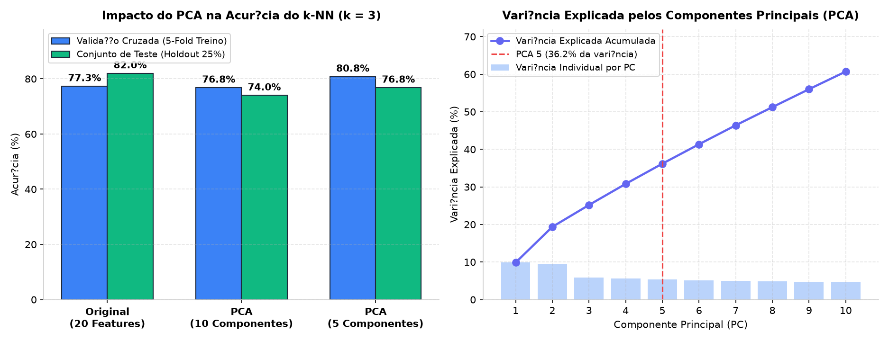
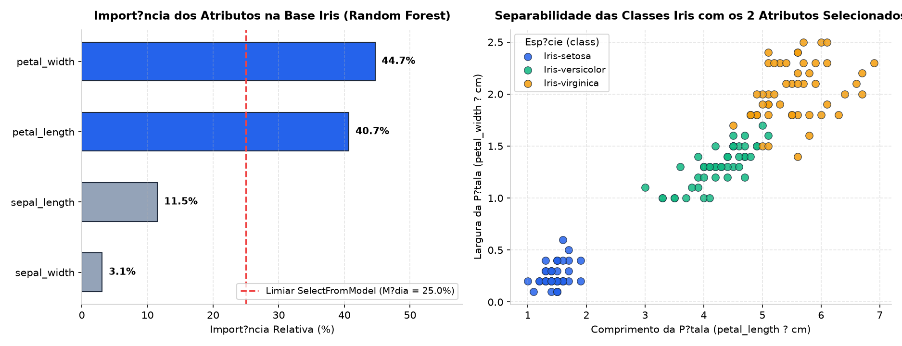
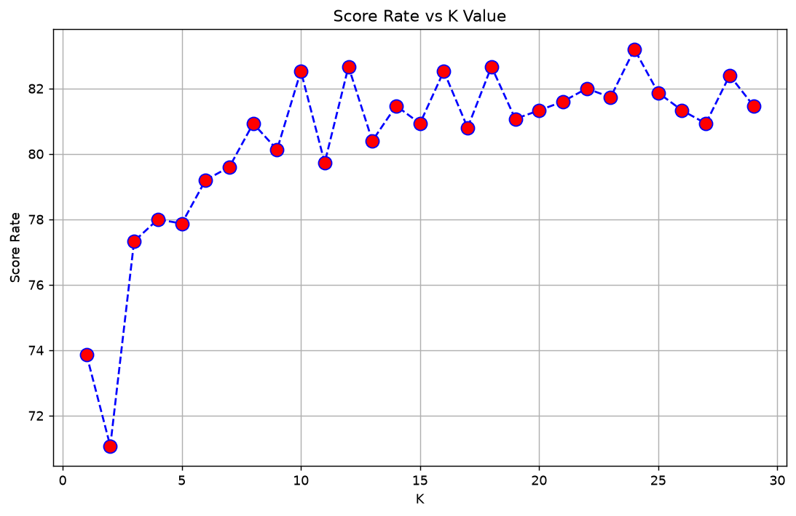
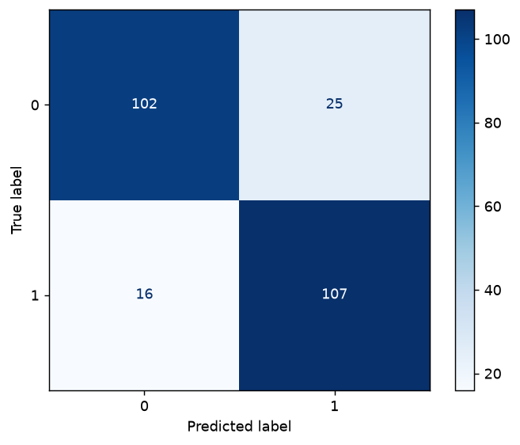
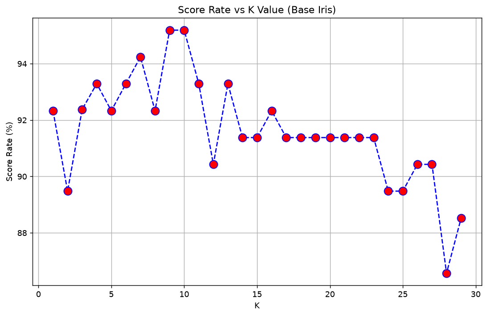
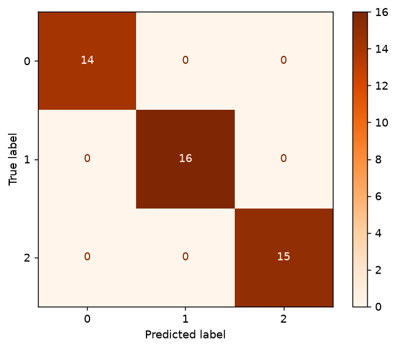

# Análise da Base do Iris — Árvore de Decisão, Feature Selection, PCA e Validação Cruzada


Projeto acadêmico da disciplina de **Modelos Preditivos Clássicos** (Especialização em Engenharia e Análise de Dados — **CESAR School**), desenvolvido pela **Equipe 04**.

O estudo avalia empiricamente três estratégias fundamentais de treinamento e validação de modelos supervisionados:
1. **Redução de Dimensionalidade Não Supervisionada com PCA (*Principal Component Analysis*):** Mitigação da maldição da dimensionalidade em uma base sintética de 20 variáveis (`make_classification`), reduzida para 10 e 5 componentes principais.
2. **Seleção de Atributos Baseada em Árvores (*Random Forest + `SelectFromModel`*):** Identificação das variáveis morfológicas mais discriminantes na **Base de Dados Iris** (`Arvore_Decisao_Iris_Data.csv`), preservando a interpretabilidade física original dos atributos.
3. **Validação Cruzada (*$k$-Fold Cross-Validation*, $cv = 5$):** Otimização robusta do hiperparâmetro $K \in [1, 29]$ do classificador **k-NN** tanto na base sintética quanto na base Iris.

---

## Sumário

1. [Visão Geral e Fluxo Experimental](#1-visão-geral-e-fluxo-experimental)
2. [Experimento 1 — Redução de Dimensionalidade com PCA](#2-experimento-1--redução-de-dimensionalidade-com-pca)
3. [Experimento 2 — Base Iris: Pré-processamento e Feature Selection com Árvores](#3-experimento-2--base-iris-pré-processamento-e-feature-selection-com-árvores)
4. [Experimento 3 — Otimização de Hiperparâmetros com Validação Cruzada (5-Fold)](#4-experimento-3--otimização-de-hiperparâmetros-com-validação-cruzada-5-fold)
5. [Síntese Comparativa: PCA vs. Feature Selection vs. Cross-Validation](#5-síntese-comparativa-pca-vs-feature-selection-vs-cross-validation)
6. [Estrutura do Repositório](#6-estrutura-do-repositório)
7. [Como Executar](#7-como-executar)
8. [Equipe](#8-equipe)

---

## 1. Visão Geral e Fluxo Experimental

O notebook [`03_Estrategias_Treinamento_Validacao_Iris.ipynb`](./03_Estrategias_Treinamento_Validacao_Iris.ipynb) conduz duas trilhas experimentais complementares:

```mermaid
flowchart TB
    subgraph Exp1["Trilha A — Base Sintética (1.000 amostras × 20 features)"]
        A1["make_classification\n(3 informativas, 17 ruído)"] --> A2["Holdout 75% / 25%\n(Treino: 750 | Teste: 250)"]
        A2 --> A3["PCA (fit no treino)\n20 → 10 e 5 Componentes"]
        A3 --> A4["k-NN (k=3) + 5-Fold CV\n& Busca K Ótimo (1..29)"]
    end

    subgraph Exp2["Trilha B — Base Iris (149 amostras × 4 atributos)"]
        B1["Coleta Base Iris CSV\n(LabelEncoder em class)"] --> B2["Holdout 70% / 30%\n(Treino: 104 | Teste: 45)"]
        B2 --> B3["StandardScaler\n(fit_transform no treino)"]
        B3 --> B4["Random Forest + SelectFromModel\n(Seleção de petal_length e petal_width)"]
        B4 --> B5["k-NN + 5-Fold CV (K=1..29)\nAcurácia de 100% no Teste (K=9)"]
    end
```



---

## 2. Experimento 1 — Redução de Dimensionalidade com PCA

A base sintética foi gerada via `sklearn.datasets.make_classification` com **1.000 amostras** e **20 atributos** (`n_informative = 3`, `n_redundant = 0`, `n_classes = 2`, `random_state = 0`), dividida em **750 amostras de treino (75%)** e **250 de teste (25%)** (`random_state = 111`).

Aplicou-se o **PCA** ajustado estritamente no treino (`fit_transform` em `X_train` e `transform` em `X_test`) para projetar os dados em **10 componentes** e **5 componentes**, avaliando em seguida um classificador **k-NN ($k = 3$)** via validação cruzada de 5 *folds* e no conjunto de teste:

<p align="center">
  
</p>

### Resultados do Experimento com PCA ($k = 3$)

| Espaço de Atributos | Dimensão (`X_train`) | Acurácia 5-Fold CV (Treino) | Precision / Recall / F1 (Teste) | Acurácia (Teste) | Interpretação |
| :--- | :-: | :-: | :-: | :-: | :--- |
| **Original (Todas as Features)** | `(750, 20)` | 77,0% (± 7,0%) | 0,82 / 0,82 / 0,82 | **82,0%** | Alta variância na validação cruzada devido às 17 features de ruído |
| **PCA — 10 Componentes** | `(750, 10)` | 77,0% (± 4,0%) | 0,74 / 0,74 / 0,74 | 74,0% | Reduz o desvio-padrão entre *folds* de ±7% para ±4% |
| **PCA — 5 Componentes** | `(750, 5)` | **81,0% (± 3,0%)** | 0,77 / 0,77 / 0,77 | 77,0% | **Melhor generalização e estabilidade no CV (+4 p.p.)**, filtrando ruído |

---

## 3. Experimento 2 — Base Iris: Pré-processamento e Feature Selection com Árvores

### 3.1. Descrição e Preparação da Base Iris
A base utilizada ([`Arvore_Decisao_Iris_Data - Arvore_Decisao_Iris_Data.csv`](./Arvore_Decisao_Iris_Data%20-%20Arvore_Decisao_Iris_Data.csv)) contém **149 registros** sem valores nulos distribuídos em 3 espécies (`Iris-setosa`: 49, `Iris-versicolor`: 50, `Iris-virginica`: 50):

| Atributo | Descrição Morfológica | Média ± Desvio-Padrão | Mín — Mediana — Máx | Importância (Random Forest) | Status (`SelectFromModel`) |
| :--- | :--- | :-: | :-: | :-: | :-: |
| **`petal_width`** | Largura da pétala (cm) | 1,20 ± 0,76 | 0,10 — 1,30 — 2,50 | **44,68%** | **Selecionada ($\ge 25\%$)** |
| **`petal_length`** | Comprimento da pétala (cm) | 3,77 ± 1,76 | 1,00 — 4,40 — 6,90 | **40,69%** | **Selecionada ($\ge 25\%$)** |
| `sepal_length` | Comprimento da sépala (cm) | 5,85 ± 0,83 | 4,30 — 5,80 — 7,90 | 11,53% | Descartada ($< 25\%$) |
| `sepal_width` | Largura da sépala (cm) | 3,05 ± 0,43 | 2,00 — 3,00 — 4,40 | 3,10% | Descartada ($< 25\%$) |

### 3.2. Seleção de Atributos via `RandomForestClassifier` + `SelectFromModel`
Após codificar a variável alvo com `LabelEncoder` (`0 = Iris-setosa`, `1 = Iris-versicolor`, `2 = Iris-virginica`), dividir em **70% treino (104 amostras)** e **30% teste (45 amostras)** e padronizar com `StandardScaler`:
- O modelo ensemble de árvores de decisão (`RandomForestClassifier`) revelou que **`petal_width` (44,68%)** e **`petal_length` (40,69%)** concentram sozinhos **85,37%** do ganho de pureza (redução de impureza de Gini).
- Utilizando `SelectFromModel` (limiar automático = média das importâncias = $25\%$), o espaço foi reduzido de 4 para apenas **2 atributos**, preservando total interpretabilidade biológica.
- Tanto o **Random Forest** quanto o **k-NN ($k=3$)** treinados **exclusivamente com as 2 variáveis selecionadas** atingiram **100% de acurácia, precisão, recall e F1-score** nos 45 exemplos de teste (e **93% ± 10%** na validação cruzada de 5 *folds* no treino).

<p align="center">
  
</p>

---

## 4. Experimento 3 — Otimização de Hiperparâmetros com Validação Cruzada (5-Fold)

Para evitar escolhas arbitrárias de $K$ ou dependentes de uma única partição treino/teste, executou-se uma busca exaustiva com **Validação Cruzada de 5 *Folds*** para $K \in \{1, 2, \dots, 29\}$ em ambas as bases:

### 4.1. Base Sintética (20 Features): Melhor $K = 24$
- A validação cruzada identificou **$K = 24$** como o hiperparâmetro ótimo, alcançando **83,20% de acurácia média no CV** e elevando a acurácia no conjunto de teste para **84,0%** (F1 = 0,83 na classe 0 e 0,84 na classe 1).

| Score de Validação Cruzada vs. $K$ (Base Sintética) | Matriz de Confusão no Teste ($K = 24$) |
| :-: | :-: |
|  |  |

### 4.2. Base Iris Padronizada: Melhor $K = 9$
- Na base Iris padronizada, a validação cruzada de 5 *folds* identificou **$K = 9$** como o ponto ótimo (**95,19% de acurácia média no CV**).
- Avaliado no conjunto de teste ($N = 45$), o modelo com **$K = 9$** alcançou **100% de acurácia** (0 erros de classificação nas 3 espécies).

| Score de Validação Cruzada vs. $K$ (Base Iris) | Matriz de Confusão no Teste — Iris ($K = 9$) |
| :-: | :-: |
|  |  |

---

## 5. Síntese Comparativa: PCA vs. Feature Selection vs. Cross-Validation

| Técnica Avaliada | Principal Benefício Observado | Limitação / Trade-off | Resultado Chave no Estudo |
| :--- | :--- | :--- | :--- |
| **PCA (*Principal Component Analysis*)** | Combina variáveis correlacionadas e filtra dimensões de ruído puro, melhorando a métrica de distância do k-NN. | Os componentes principais são combinações lineares abstratas, perdendo a interpretabilidade direta das colunas originais. | Elevou a acurácia de CV da base sintética de **77% ($\pm 7\%$) para 81% ($\pm 3\%$)** com 5 componentes. |
| **Feature Selection (*Random Forest + `SelectFromModel`*)** | Elimina variáveis irrelevantes mantendo os atributos originais intactos e 100% interpretáveis. | Não cria combinações ortogonais quando a informação está espalhada de forma fraca por muitas colunas. | Isolou `petal_width` e `petal_length` (**85,4%** da importância), atingindo **100% de acerto no teste**. |
| **$k$-Fold Cross-Validation ($cv=5$)** | Estima o erro de generalização em múltiplas partições, prevenindo *overfitting* ($K$ muito baixo) e *underfitting* ($K$ excessivo). | Custo computacional multiplicado pelo número de *folds* ($5\times$). | Determinou com segurança **$K=24$** (84% teste) na base sintética e **$K=9$** (100% teste) na base Iris. |

---

## 6. Estrutura do Repositório

```text
├── assets/                                                            # Gráficos extraídos dos experimentos e painéis analíticos
│   ├── cv_score_vs_k_iris.png
│   ├── cv_score_vs_k_sintetico.png
│   ├── importancia_atributos_iris_rf.png
│   ├── matriz_confusao_iris_k_otimo.png
│   ├── matriz_confusao_sintetico_k_otimo.png
│   └── pca_comparativo_acuracia.png
├── 03_Estrategias_Treinamento_Validacao_Iris.ipynb                    # Notebook principal com código, saídas e conclusões
├── Arvore_Decisao_Iris_Data - Arvore_Decisao_Iris_Data.csv            # Conjunto de dados Iris utilizado na atividade
├── .gitignore                                                         # Regras de exclusão de ambientes virtuais e caches
├── requirements.txt                                                   # Dependências Python para reprodução
└── README.md                                                          # Documentação detalhada do projeto
```

---

## 7. Como Executar

Recomendado: **Python 3.10** ou superior.

1. Clone este repositório e acesse a pasta:
   ```bash
   git clone https://github.com/pepsbr/analise-da-base-do-iris-arvore-de-decisao.git
   cd analise-da-base-do-iris-arvore-de-decisao
   ```
2. Crie e ative um ambiente virtual Python:
   ```bash
   python -m venv .venv
   .\.venv\Scripts\Activate.ps1
   ```
3. Instale as dependências:
   ```bash
   python -m pip install -r requirements.txt
   ```
4. Inicie o Jupyter Notebook e execute as células em ordem:
   ```bash
   jupyter notebook 03_Estrategias_Treinamento_Validacao_Iris.ipynb
   ```

---

## 8. Equipe

Trabalho desenvolvido pela **Equipe 04** — CESAR School:

- **Mauro Roberto Barbosa Cahu**
- **Pedro Paulo Sant'Anna Belo Ramos**
- **Renato Vasconcellos Bittencourt Neto**
- **Vinicius Dantas Batista da Silva**
